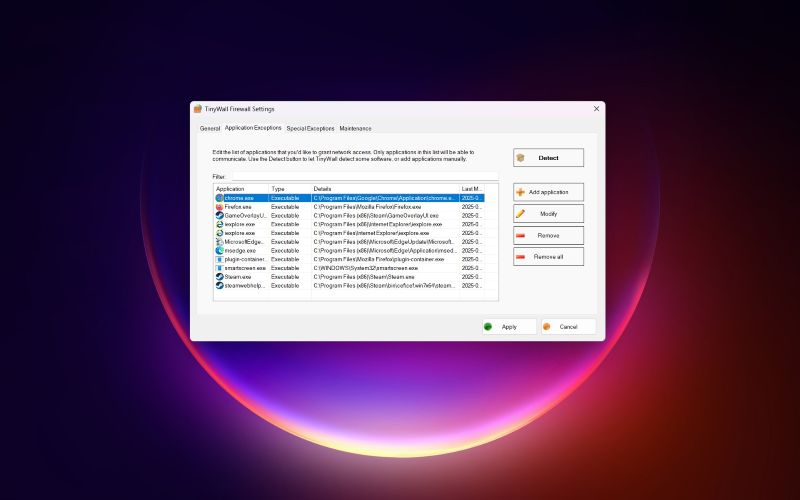
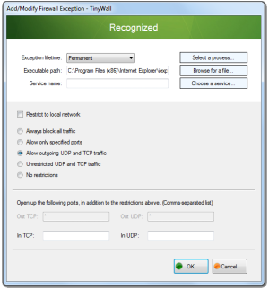

# TinyWall for Quiet Windows Network Access Control

TinyWall Firewall provides application-based network control without repeated connection prompts.
TinyWall runs from the Windows system tray and lets you decide which applications may communicate.
Review tinywall firewall rules when a program needs access to a particular network resource.
Use tinywall autolearn mode for a limited learning period and inspect the resulting exceptions.
With tinywall IPv6 support, review connectivity across both address families.

[](https://tinywall-firewall.github.io/TinyWall/)

This overview accompanies a partial snapshot of TinyWall's supporting source libraries.
The supplied files cover filtering wrappers, Windows integration, utilities, and installer resources.
The main application project and complete build inputs are absent from this snapshot.

## About

TinyWall is a free and open-source firewall for Windows.
Its application allowlist helps keep network access limited to programs you have approved.
The interface emphasizes deliberate exceptions instead of asking about every new connection.

TinyWall uses Windows filtering facilities without installing a custom kernel driver.
Its design includes tampering protection and controls for temporary or restricted application access.
The product is offered without advertising, telemetry, or paid feature tiers.

A useful configuration starts with the applications you actually use.
Review exceptions when software is replaced, removed, or moved to another location.
Keep the set of allowed applications understandable enough to inspect later.

## Features

The available modes support different kinds of network access decisions.
Choose a mode with its effect on the whole computer in mind.

| Control | Intended use | Review point |
| --- | --- | --- |
| Normal Protection | Enforce the configured application exceptions | Confirm required programs are allowed |
| Allow Outgoing | Permit outgoing communication more broadly | Check whether this matches your intended policy |
| Block All | Temporarily stop network communication | Expect active network tasks to be interrupted |
| Autolearn | Observe applications and create exceptions | Review learned entries after leaving the mode |
| LAN-only access | Restrict an exception to local networking | Test the actual local service you need |
| Temporary exceptions | Allow access for a limited period | Check the duration and application identity |
| Blocklists | Apply additional restrictions | Review these when an allowed application still fails |

Keep the distinction between a global mode and an individual application exception clear.
Changing the mode can affect software beyond the program currently being investigated.

- Allow the executable that performs the network operation.
- Check helper processes used by larger applications.
- Review service and UWP application exceptions separately.
- Remove temporary allowances when their purpose has ended.
- Keep IPv4 and IPv6 behavior in the same review.



The supplied networking helpers include:

- [IPVersion.cs](pylorak.Windows/NetStat/IPVersion.cs), which identifies IPv4 and IPv6 address families.
- [NetworkAdapterEnumerator.cs](pylorak.Windows/NetworkAdapterEnumerator.cs), which wraps Windows adapter enumeration.

## Rules editor

Application exceptions should describe a specific need.
A browser, a local media service, and an update helper may need different access.
Use the narrowest available setting that still supports the intended task.

When a program cannot connect, identify the process responsible for its traffic.
The visible application window may belong to a different executable from its network helper.
TinyWall's Connections window can help locate recently blocked processes.

A practical exception review follows a repeatable sequence:

1. Reproduce the failed operation once.
2. Inspect the newly blocked entries.
3. Confirm which executable belongs to the application.
4. Add or adjust its exception.
5. Repeat the same operation to check the result.

Autolearn temporarily allows communication while collecting application activity.
After leaving it, remove learned entries that should not retain access.
The documented learning limitations include system processes and Windows services.

Filtering and process identity are represented in these supporting files:

- [Filter.cs](pylorak.Windows.WFP/Filter.cs) defines filtering objects, actions, and flags.
- [FilterCondition.cs](pylorak.Windows.WFP/FilterCondition.cs) defines filter matching conditions.
- [FilterConditionList.cs](pylorak.Windows.WFP/FilterConditionList.cs) manages collections of conditions.
- [ProcessManager.cs](pylorak.Windows/ProcessManager.cs) provides process information helpers.

These are implementation components rather than a standalone rule configuration format.

## Base Technology

Windows Filtering Platform provides the underlying filtering facilities used by TinyWall.
The supplied C# wrappers expose native filtering operations and related data structures.
They are supporting libraries and do not replace the missing application policy logic.

Several files describe how filtering resources are managed:

- [Engine.cs](pylorak.Windows.WFP/Engine.cs) wraps access to the native filtering engine.
- [Transaction.cs](pylorak.Windows.WFP/Transaction.cs) supports transaction handling.
- [NetEventSubscription.cs](pylorak.Windows.WFP/NetEventSubscription.cs) defines network event subscription support.
- [LayerKeys.cs](pylorak.Windows.WFP/LayerKeys.cs) provides identifiers for filtering layers.

Other components support work outside the visible tray interface:

- [ServiceBase.cs](pylorak.Windows.Services/ServiceBase.cs) provides Windows service infrastructure.
- [BackgroundTask.cs](pylorak.Utilities/BackgroundTask.cs) manages a cancellable background task.

Understanding these boundaries helps keep source review focused.
A change to a wrapper can affect several application behaviors that use the same Windows facility.
Review resource lifetime and error handling alongside the immediate filtering operation.



## Command line

TinyWall documents a developer command for generating its known-application database.
This command is separate from normal tray-based application management.
The following PowerShell example requires a full upstream checkout and an available TinyWall.exe.
Run it from that checkout's root, with the executable discoverable on PATH.

```powershell
$databaseSource = Join-Path $PWD "TinyWall\Database"
$databaseOutput = Join-Path $PWD "database-output"
& TinyWall.exe database-creator /source-folder $databaseSource /output-folder $databaseOutput
```

The command generates a profiles.json database from the source definitions.
The database source folder and executable required by this example are absent from the supplied snapshot.
Use the complete upstream development instructions when working on the database.
This example does not add an application exception to a running firewall.

## System requirements

The current TinyWall download supports Windows 10 and Windows 11.
The official download page provides x86/x64 and ARM64 packages.
Select the package that matches the target system's architecture.

The downloaded source snapshot is not a runnable distribution.
Supporting libraries and installer resources alone are insufficient to reproduce the application.
Check the complete upstream project when evaluating development dependencies.

## Additional information

The supplied sources also include helpers for monitoring and integrity-related operations.
Read their individual responsibilities before attributing behavior to the application as a whole.

- [RegistryWatcher.cs](pylorak.Windows/RegistryWatcher.cs) provides registry change notifications.
- [WinTrust.cs](pylorak.Windows/WinTrust.cs) wraps signature verification support.
- [TrafficRateMonitor.cs](pylorak.Windows/TrafficRateMonitor.cs) reads network interface traffic counters.
- [build-config.ini.template](build-config.ini.template) documents settings used by the upstream release process.

For a complete upstream release workspace, the following INI excerpt illustrates three template keys.
The paths and example domain are placeholders to replace for that workspace.

```ini
staging-folder = C:\TinyWallBuild\MsiSetup\Sources
update-url = https://updates.example.org/tinywall
update-output = C:\TinyWallBuild\Update
```

This is a partial build configuration, not a firewall policy file.
It does not change installed protection modes, exceptions, or blocklists.
The full release process requires additional configuration and files absent here.

## FAQ

**Why does an allowed application still fail to connect?**

Check whether a helper executable or service performs the network operation.
Also review the active protection mode and applicable blocklist settings.

**Does autolearn replace manual review?**

Learned exceptions still need inspection after the learning period.
Remove entries that do not belong in the intended application allowlist.

**Should IPv6 be considered during troubleshooting?**

Review the connection's actual address family rather than assuming every application uses IPv4.
A useful report includes the destination, process, and attempted operation.

## Contributing

Keep changes aligned with TinyWall's small and focused design.
Describe the observed behavior, expected result, and conditions needed to reproduce it.
For larger changes, discuss the approach with the upstream maintainer first.

- Identify the Windows version and processor architecture.
- State the active mode when describing a filtering issue.
- Name the affected application and relevant helper process.
- Remove personal addresses and sensitive application data from reports.
- Distinguish library changes from missing application-level functionality.

## Related Search Terms

TinyWall Firewall, TinyWall, tinywall firewall rules, tinywall autolearn mode, tinywall IPv6 support, firewall, application-firewall, windows, windows-firewall, wfp, network, privacy, open-source, ipv6, arm64
